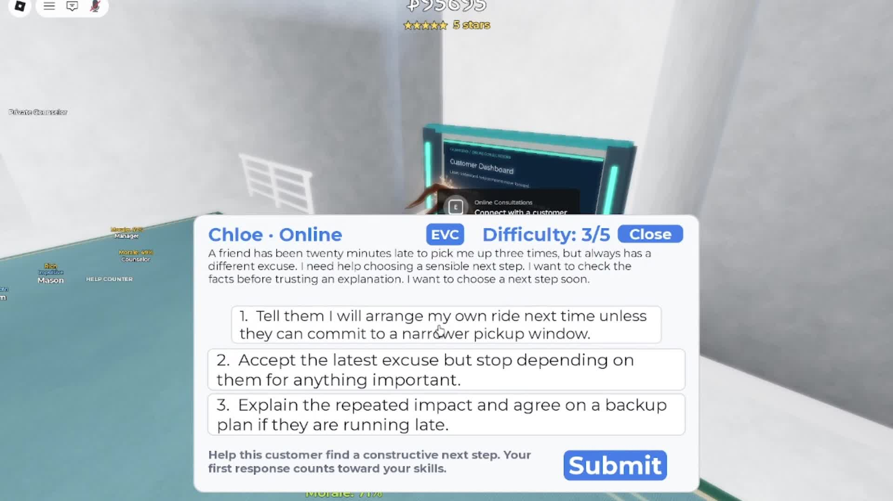

# CalmWorks

**CalmWorks** is a Roblox educational business simulation for practicing thoughtful responses to everyday disagreements. Created for the **2026 Congressional App Challenge**, it combines realistic customer situations, feedback, adaptive practice, and a growing in-game business.



## Try it

- **Play the published experience:** https://www.roblox.com/games/137721325206604/CalmWorks
- **Watch the 2026 CAC demonstration:** https://www.youtube.com/watch?v=z6danf7mGwI

## Features

- **Interactive practice:** Three-choice or written responses with constructive, scenario-specific feedback.
- **Curated cases:** 100 scenarios across 10 categories, including 40 linked multistage conversations (140 dialogue stages total).
- **Adaptive recommendations:** First-attempt results from a rolling window of up to 50 responses inform category practice. Selection increases attention to weaker areas while preserving variety.
- **Business simulation:** Employees, managers, customer personalities, workplace concerns, private guidance sessions, online consultations, NPC routing, and four expansions.
- **Progress:** Category statistics, a radar visualization, historical snapshots, and saved business progression.
- **AI-backed interactions:** Roblox's existing TextGenerator generates candidate scenarios and support responses; structured checks, independent review, filtering, and curated fallbacks reduce unsuitable or inconsistent results.

## Technology

- Roblox Studio and **Luau**
- Server-authoritative gameplay, with clients handling UI and user input
- Roblox PathfindingService, DataStore APIs, and TextGenerator
- Modular scenario, adaptive-practice, NPC, employee, dashboard, and save systems

## Open and run in Roblox Studio

1. Install **Roblox Studio** and sign in with a Roblox account.
2. Download this repository, including the full Studio place file at `game/CalmWorks.rbxl` and the readable Luau source under `src/`.
3. In Roblox Studio, choose **File → Open from File** and open `game/CalmWorks.rbxl`.
4. Press **Play** to test the experience. The published Roblox link above is the easiest way to experience the live game.
5. For a separate test copy with live DataStore persistence, publish to an experience **you own** and configure any required Studio API access. Roblox TextGenerator availability and permissions may depend on your account and experience configuration. Preset scenarios provide a fallback when generation is unavailable.

Some Roblox-hosted assets or services may not transfer automatically to another account. Some Roblox-hosted assets may require separate permissions. Review and document the source and license of imported assets before redistributing them, including any Toolbox models.

## Exported source code

This repository includes the original binary Studio place file (`game/CalmWorks.rbxl`) and **100 separately extracted Luau files** in `src/` (68 ModuleScripts, 16 Scripts, 16 LocalScripts). The `src/` files are a reviewer-friendly mirror of the embedded scripts, preserving their original Studio parent paths; **the `.rbxl` file is the runnable place**, not the `src/` folder by itself. A machine-generated `SOURCE_INVENTORY.json` lists individual paths, types, source sizes, and hashes.

The export currently contains **6,798 serialized Roblox instances**. Script source line count is approximately **26,145** (including empty lines and any imported/third-party scripts). These counts document this particular place export; they do not independently verify behavior in a separate Studio session.

## Repository layout

```text
CalmWorks/
├── README.md
├── LICENSE
├── SOURCE_INVENTORY.json
├── game/
│   └── CalmWorks.rbxl           # Full Roblox Studio place export
├── src/                        # Readable Luau scripts / modules
└── assets/
    ├── CalmWorks_Certification_Gameplay.jpg
    ├── CalmWorks_Certification_Interaction.jpg
    └── CalmWorks_Certification_Progress.jpg
```

**Review note:** This repository mirrors a locally saved Studio file. The publisher should open `game/CalmWorks.rbxl` in Roblox Studio and verify the experience functions before submitting it for independent review; Roblox-hosted assets, permissions, and API features may differ by account.

## Engineering decisions

The game separates player input from authoritative server checks for answers, purchases, rewards, and progression. Scenario generation is prepared in the background; malformed choices or mismatched answer identifiers are rejected, and an approved preset scenario is used when no suitable generated content is available within the brief player-facing loading window. Save operations include validation and compatibility handling for changes between versions.

## Development and AI assistance

The creator designed the original concept, educational scenarios, progression mechanics, adaptive-practice requirements, and overall user experience, and wrote, integrated, modified, and tested Luau gameplay systems. OpenAI Codex assisted with aspects of code development, debugging, refactoring, and GUI foundations; ChatGPT assisted with dialogue, and Gemini Flash was used for artwork. Roblox's TextGenerator is an existing AI service, **not** a new model trained for this project.

## Development and Version History

CalmWorks was originally developed in Roblox Studio for the 2026 Congressional App Challenge. Most of the project's development occurred directly within Roblox Studio before this GitHub repository was created.

As a result, the GitHub commit history primarily documents the process of exporting, organizing, documenting, and publishing the completed project as open source, rather than its entire development timeline.

Roblox maintains a separate version history of saved and published versions of the original CalmWorks experience. These earlier versions can be accessed by the creator through Roblox Studio (**Window → Version History**) or the Roblox Creator Dashboard.

The file `game/CalmWorks.rbxl` represents an exported snapshot of the project, while `src/` provides the extracted Luau scripts for independent code inspection.

The original Roblox development history is retained separately from this repository and can be provided as supporting evidence of the project's development process upon request.

## Future work

Potential improvements include structured playtesting, a standardized assessment separate from adaptive practice, more branching conversations, accessibility refinements, and further automated tests.

## License and asset attribution

See `LICENSE` for the terms covering original code you have the rights to release. **Do not assume the license covers third-party code, Roblox-hosted assets, music, or Toolbox models.** In particular, verify the origin and permission status of any externally obtained models (including `EpicCowCar`, if imported). Replace or remove assets you are not authorized to redistribute, and document relevant attributions before making the whole place public.
